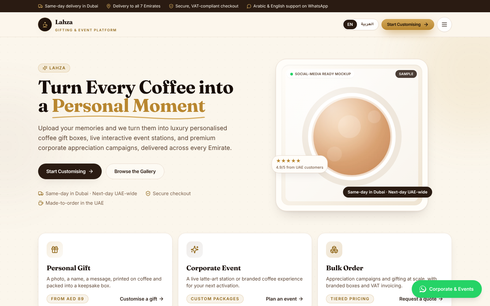
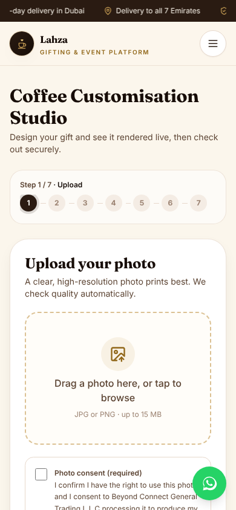
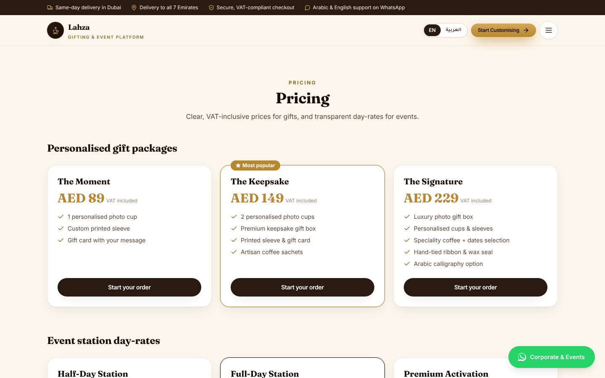

<p align="center">
  
</p>

<h1 align="center">Lahza · لحظة</h1>

<p align="center">
  Personalised coffee gifts, live event coffee stations, and corporate appreciation campaigns for the UAE.
  <br />
  A bilingual (English / Arabic, RTL) commerce storefront with a built-in operations console.
</p>

<p align="center">
  <a href="https://github.com/ahmadzayan-hub/lahza/actions/workflows/ci.yml"></a>
  
  
  
  
  
</p>

<p align="center">
  <a href="#features">Features</a> ·
  <a href="#screens">Screens</a> ·
  <a href="#getting-started">Getting started</a> ·
  <a href="#deployment">Deployment</a> ·
  <a href="#project-structure">Structure</a> ·
  <a href="#status-and-known-gaps">Status</a>
</p>

<p align="center">
  
</p>

> The hero and packaging images in this README are **code-generated vector illustrations** rendered from SVG, not photographs or AI-generated photos. They are placeholders for brand photography.

---

## Overview

Lahza is a customer-facing storefront plus a demo operations console for **Beyond Connect General Trading L.L.C**, Dubai.

| | |
|---|---|
| **Customers** | Gift buyers, event hosts, and corporate teams across the seven Emirates |
| **Core job** | Design a personalised coffee gift or book a coffee station, then pay online or request a WhatsApp payment link |
| **Staff tooling** | An operations console at `/console` (overview, orders, leads, approvals, corporate accounts, inventory), demo data only |
| **Languages** | English (LTR) and Arabic (RTL), switchable at any time |

## Features

**Customer journey**

- **Three entry paths** on the home page: personal gift, corporate event, bulk order.
- **Seven-step customisation studio** with a live, SVG-rendered preview of cup, sleeve, box and card.
- **Image quality check** on upload, plus client-side cleanup and auto-crop for cups and boxes.
- **Gift message assistant** in Arabic and English, with tone selection.
- **Arabic name spelling helper** that uses a curated map and flags phonetic guesses.
- **Delivery to all seven Emirates** with date and time selection.
- **Corporate quotations** with VAT-exclusive B2B pricing, exported as a printable PDF.

**Platform**

- **Bilingual UI** with `dir` switched on the document, not just the text.
- **Installable PWA** with a manifest and service worker.
- **Route-level code splitting**, so the home page loads without the customiser, admin or legal pages.
- **Compliance-oriented copy**: VAT-inclusive consumer prices, a non-returnable notice for personalised goods, and photo-consent and retention wording for PDPL.

**Operations**

- **Console at `/console`** with overview, orders, leads, approvals, corporate accounts and inventory tabs, all on demo data.

**Integration seams**

- `src/lib/ai.ts` contains swappable AI interfaces. They run deterministically with no keys. Set `VITE_AI_ENDPOINT` to route generation and image moderation to a real provider.
- Payments, WhatsApp Business API and moderation keys belong on a server. See [Recommended production wiring](#recommended-production-wiring).

## Screens

<table>
  <tr>
    <td width="60%"></td>
    <td width="40%"></td>
  </tr>
  <tr>
    <td colspan="2"></td>
  </tr>
</table>

The customisation studio shows the current step name on phones (`Step 1 / 7 · Upload`), and the full step track from the `sm` breakpoint up. Each step has `aria-current="step"`.

## Stack

| Layer | Choice |
|---|---|
| UI | React 18, TypeScript (strict) |
| Build | Vite 5 |
| Styling | Tailwind CSS 3 with logical properties (`ps`/`pe`/`ms`/`me`), so layouts mirror in RTL |
| Routing | react-router-dom 7, lazy routes |
| Icons | lucide-react |
| i18n | Custom dictionaries in `src/i18n`. English is the source, Arabic is type-checked against the same shape |

Runtime dependencies are deliberately small: no charting, animation or PDF libraries. The PDF quotation uses the browser's print-to-PDF.

## Getting started

Requires Node.js 20 or newer.

```bash
git clone https://github.com/ahmadzayan-hub/lahza.git
cd lahza
npm ci
npm run dev          # http://localhost:5173
```

### Scripts

| Command | What it does |
|---|---|
| `npm run dev` | Start the Vite dev server |
| `npm run typecheck` | `tsc --noEmit` |
| `npm run lint` | ESLint over `src/` |
| `npm run build` | Typecheck, then produce `dist/` |
| `npm run preview` | Serve the production build locally on port 4173 |

CI (`.github/workflows/ci.yml`) runs lint and build on every push and pull request to `main`.

### Configuration

Copy `.env.example` to `.env.local` if you need an AI endpoint. Every variable is optional for the demo.

| Variable | Purpose |
|---|---|
| `VITE_AI_ENDPOINT` | Optional. Routes AI generation and image moderation to a server endpoint. Unset means built-in templates and heuristics. |

Do not put payment, WhatsApp or other secret keys in `VITE_*` variables. They end up in the client bundle.

## Deployment

The repository root is a plain Vite app, so both hosts build it without subfolder settings.

- **Vercel**: `vercel.json` rewrites all routes to `index.html` and sets long-cache headers for `/assets/*`, plus a Content-Security-Policy and other security headers.
- **Netlify**: `netlify.toml` provides the same SPA fallback, cache headers and security headers, with Node 20.

Both files set the same CSP. If you add a third-party script, font or API origin, update both.

Before launch, confirm the seller identity in `src/lib/brand.ts`. The licence number and TRN there are placeholders marked `TODO`.

## Project structure

```
src/
  App.tsx                  routes (lazy) and the console route
  components/              Header, Footer, Stepper, ProductPreview, Layout, ...
  pages/                   Home, Customize, Gallery, Corporate, Pricing, FAQ, Legal, ...
    customize/             step components, types, totals, order message
    admin/                 operations console at /console
  lib/                     catalog, brand, quotation, whatsapp, ai seams, image quality
  i18n/                    en.ts (source), ar.ts, dict.ts, I18nContext
public/                    logo, icons, manifest, service worker, sample and gallery images
docs/                      threat models and deployment notes
```

## Status and known gaps

This is a working demo, not a live store.

- **Payments** (Telr or PayTabs, Tabby, Tamara, Apple Pay, Google Pay) are not wired. Checkout currently hands the order to WhatsApp. The FAQ and legal pages describe payment methods that the code does not yet process, so that copy must be aligned before launch.
- **Seller identity** includes placeholder licence and TRN values that must be confirmed.
- **Gallery** uses illustrative product tiles, not customer photos.
- **AI features** run deterministically until `VITE_AI_ENDPOINT` points to a real service.
- **Operations console** works on demo data only.
- **No license file** has been added yet. Until one is, the code is not open for reuse.

Security notes are in [`docs/THREAT_MODEL.md`](docs/THREAT_MODEL.md).

## Recommended production wiring

- **Payments**: Telr or PayTabs, plus Tabby and Tamara, Apple Pay and Google Pay, cash on delivery, and corporate payment links.
- **Hosting and data residency**: a UAE cloud region for uploaded photos and invoice data, with lifecycle rules that purge source images after fulfilment.
- **Messaging**: WhatsApp Business API through a business solution provider for order, utility and one-time-password messages.

## Contributing

Use a branch and open a pull request against `main`. CI must pass (`npm run lint` and `npm run build`).

Keep both languages in step: every user-facing string goes into `en.ts` and `ar.ts`, and the type checker enforces matching keys.
